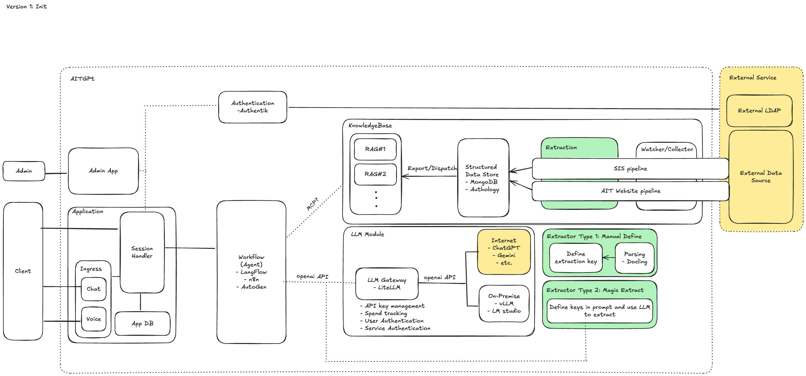

# AITGPT

- [AITGPT](#aitgpt)
  - [Resources](#resources)
  - [Architecture Design](#architecture-design)
  - [Getting Started](#getting-started)
    - [Clone the repository](#clone-the-repository)
  - [Overview](#overview)

## Resources

DEMO link: https://chatbot.aitgpt.dev.brain.cs.ait.ac.th

Figma Design: https://rotate-patron-64957611.figma.site

Google Share Drive: https://drive.google.com/drive/folders/0ANPg5r7q7SajUk9PVA

Main Proposal: https://docs.google.com/document/d/1VbmGMReHyJPyGNzG07huWWe2iPqyEBx4Hf_SARK2FmE/edit?usp=sharing

## Architecture Design



## Getting Started

### Clone the repository

To clone the repository with its submodules, run:

```bash
git clone --recurse-submodules https://github.com/AIT-brainlab/AITGPT.git
```

If you have already cloned the repository without submodules, you can initialize and update them by running:

```bash
git submodule update --init --recursive
```

## Overview

The project consists of two main components:

1. **App**: This is the main application that serves the frontend and handles user interactions. It is built using React and TypeScript.
2. **Compliance-checking**: the compliance checking module that evaluates the responses generated by the language model against predefined compliance rules. It is implemented in Python and uses FastAPI for the API layer.

